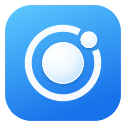
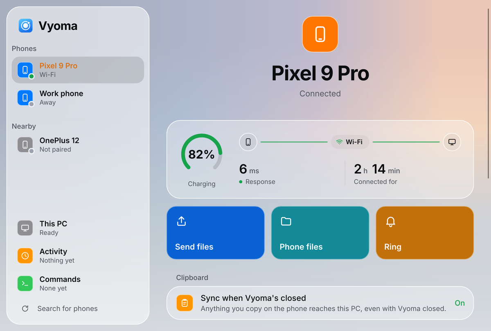
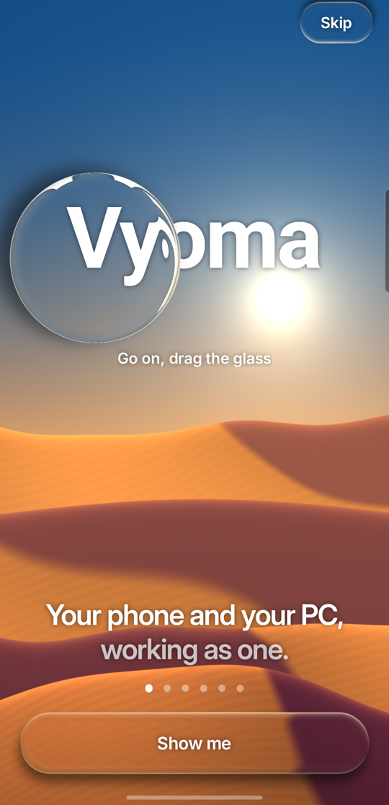
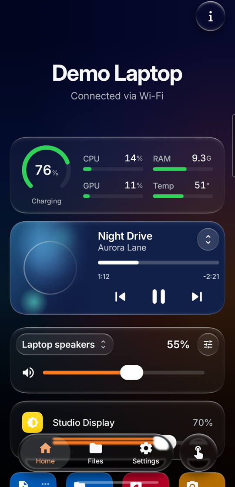
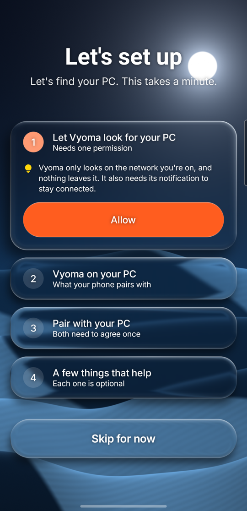
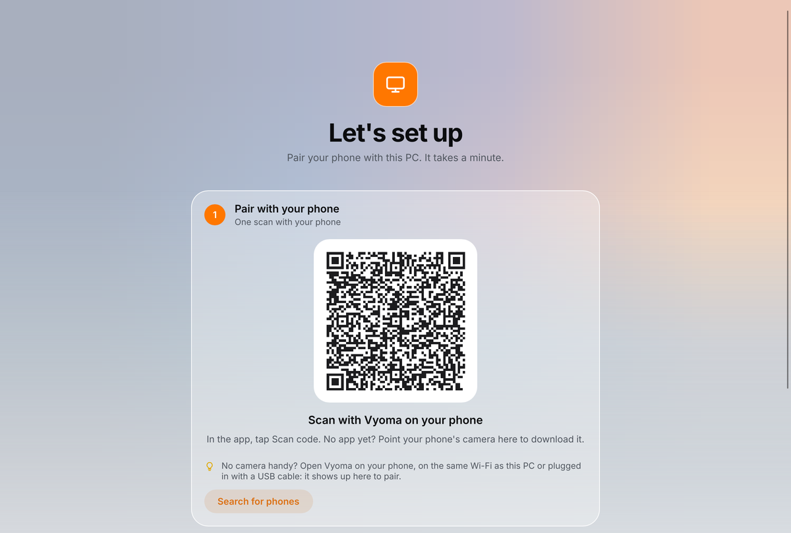
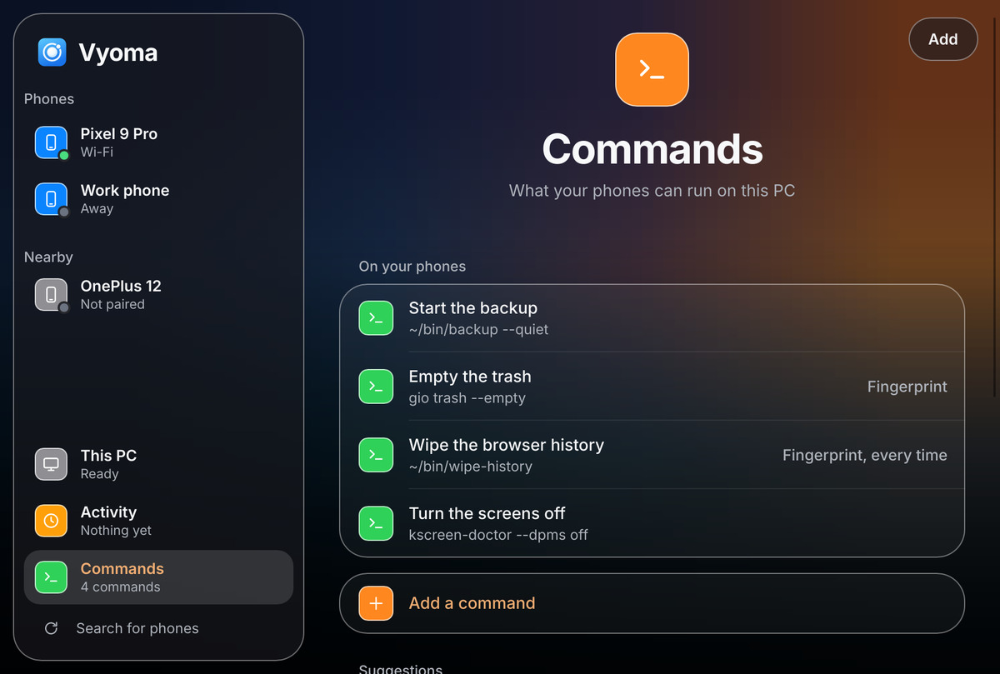

<p align="center"></p>

<h1 align="center">Vyoma</h1>

<p align="center"><b>Your Android phone and your Linux PC, working as one.</b><br>
Files, clipboard, calls, notifications, screens and remote control, all over your own network.<br>
Open source. No account. No cloud.</p>

<p align="center"><a href="https://github.com/Prajwaljb/VyomaConnect/releases/latest"><b>Download</b></a> ·
<a href="#get-started">Get started</a> ·
<a href="docs/FEATURES.md">All features</a> ·
<a href="https://github.com/Prajwaljb/VyomaConnect/issues">Report an issue</a></p>

<p align="center"></p>

Vyoma is a phone app and a PC app built to work together. It speaks the KDE Connect protocol, so
it moves into your desktop without losing a single pairing, then goes well beyond it: screen
mirroring both ways, your phone as a webcam or game controller, resumable transfers over a USB
cable, fingerprint-protected commands, and a PC window that shows exactly what each phone can do.

## What you get

<p align="center">



</p>

**Files, both ways.** Send files and whole folders in either direction: on the PC, right-click and
pick **Send to** your phone. Browse your PC from the phone, and open the phone's storage right in
your PC's file manager. A dropped connection picks up
where it left off.

**One clipboard.** Copy on one, paste on the other.

**Calls and notifications on the PC.** See who's calling and mute the ringer from your desk.

**Your PC in your pocket.** View and control its screen, grab a screenshot, snap a photo with its
camera, watch CPU, memory and temperature, set brightness and per-app volume, control music, lock
it or put it to sleep.

**Your phone as a PC accessory.** Touchpad and keyboard, presenter remote, webcam and microphone,
or a game controller with gyro aiming. Put the phone's screen in a window on the PC.

**Commands and rules.** Run your own commands on the PC from the phone, with a fingerprint check
for the sensitive ones. Rules handle the routine, like locking the PC when you walk away.

**Widgets and quick settings tiles** for everything you use most.

**Always connected.** Wi-Fi, a USB cable for top speed, Bluetooth when there's no Wi-Fi, or an IP
address for Tailscale and other VPNs. Vyoma picks the best route on its own.

**And a lot more:** see [everything Vyoma does](docs/FEATURES.md).

## Get started

Set up the PC first, then the phone.

### 1. Your PC

Vyoma runs on Linux with KDE Plasma or GNOME. Support for other desktops and macOS is coming in
future releases.

```sh
git clone https://github.com/Prajwaljb/VyomaConnect && VyomaConnect/desktop/daemon/install.sh
```

The installer builds Vyoma, adds it to your app menu, starts it at login and takes over from KDE
Connect with your pairings intact. It asks for your password once, to install what it needs and
let phones through the firewall. Prefer KDE Connect after all? `install.sh --undo` puts it back.

On GNOME, the installer also adds Vyoma's small GNOME Shell extension, which clipboard sync, the
presenter's pointer and replying to notifications need. Log out and back in once to turn it on.
GSConnect is switched off while Vyoma runs, as both use the same port.

When a new version is out, Vyoma tells you and updates itself with one click, your pairings kept
(or run `install.sh --update`).

**On Arch or CachyOS?** Build it as a package instead, so pacman keeps track of it:

```sh
git clone https://github.com/Prajwaljb/VyomaConnect && cd VyomaConnect/packaging/aur && makepkg -si
/usr/share/vyoma/install.sh
```

### 2. Your phone

Download the APK from [Releases](https://github.com/Prajwaljb/VyomaConnect/releases/latest) and
open it. Android 12 or newer.

To get every update automatically, add this repository to
[Obtainium](https://github.com/ImranR98/Obtainium):
`https://github.com/Prajwaljb/VyomaConnect`.

The signing certificate's SHA-256 fingerprint, for anyone who checks
(`apksigner verify --print-certs`):

```
7F:EB:FF:09:7C:EF:AA:F1:2C:CF:3A:C6:ED:2E:C8:EA:A0:C0:9A:7A:0A:77:83:8B:B8:2E:E5:3E:00:04:84:B1
```

### 3. Pair

Open Vyoma on both. The phone and the PC walk you through the same steps: pick your PC, confirm the
code matches on both screens, done. From then on they find each other automatically.

<p align="center"></p>

## Good to know

**Works with KDE Connect and GSConnect too.** The phone app pairs with either one and covers the
essentials: files, clipboard, notifications, media, commands, touchpad and presenter. Vyoma's PC
app unlocks everything else.

**Clipboard in the background.** Android lets only the app on screen read the clipboard. Vyoma
works around that: plug the phone into the PC once with USB debugging on and click **Allow** on the
phone's page in Vyoma's window. After that, copies reach the PC even with Vyoma closed. When the
app restarts, Android asks once for log access: tap **Allow one-time access**. The Clipboard page
also has a Send button for a quick manual push.

**Private by design.** Your phone and PC talk directly, encrypted, over your own network, cable or
Bluetooth. No account, no server. The only thing that goes online is the PC app's daily look for a
new version on GitHub, which you can turn off on **This PC**. Pairing needs a matching code on both screens, the PC window
decides what each phone may do, and the phone can ask for your fingerprint before it unlocks the
PC, opens its files or shows its screen.

<p align="center"></p>

## Something not right?

[Open an issue](https://github.com/Prajwaljb/VyomaConnect/issues) and say what you did, what
happened, and which phone, distro and desktop you're on. Vyoma is built on KDE Plasma 6 and GNOME
with Wayland; the installer also supports Debian, Ubuntu and Fedora, and reports from those are
especially welcome.

## Build it yourself

```sh
# Phone app (JDK 21 and the Android SDK)
./gradlew :app:assembleRelease

# PC app and its window (Rust)
(cd desktop/daemon && cargo build --release)
(cd desktop/gui && cargo build --release)
```

`./gradlew :app:assembleDemo` builds a demo with a simulated PC, no network needed. The
architecture is in [docs/PLAN.md](docs/PLAN.md).

## Licence

GPL-3.0-or-later, like KDE Connect. Vyoma is an independent project, not affiliated with KDE.
