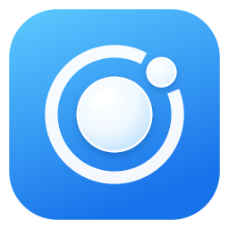

<h1 align="center">Everything Vyoma does</h1>

The full list, phone and PC. Features marked <b>PC app</b> need Vyoma's PC app; the rest also work
when the phone is paired with KDE Connect or GSConnect.

---

## Files

- **Send files and whole folders, both ways.** Folders keep their structure on the other side.
- **Right-click → Send to your phone** in Dolphin, Thunar, Nautilus, Nemo and Caja. *PC app*
- **Share from any phone app** with Android's share sheet; long-press Send files to pick photos or a folder.
- **Transfers resume** after a dropped connection instead of starting over. *PC app*
- **Browse your PC's files from the phone:** open, save to the phone, or upload into any folder. *PC app*
- **Open the phone's storage in your PC's file manager.** With the PC app it shows up in the sidebar, in Dolphin
  and the GTK file managers alike, and the PC checks it's really your phone before it connects.
- **A transfer list** with progress, so you always know what arrived and where.
- **USB cable speed:** around 70 MB/s over the cable, picked automatically when it's plugged in. *PC app*

## Clipboard

- **Copy on one side, paste on the other**, text and links.
- **Works with the phone app closed**, after a one-time step from the PC window; USB debugging can go off again
  afterwards. *PC app*
- **Clipboard history** on the phone: tap any past copy to use it again.
- **Respects sensitive copies:** passwords marked private by your password manager never leave the phone.
- A **Send button**, Quick Settings tile and widget for a one-tap push.

## Notifications and calls

- **Phone notifications on the PC**, with their buttons, and inline replies where the desktop supports them.
- **Pick which apps** may notify the PC.
- **Incoming calls on the PC**, including WhatsApp and other internet calls, with **Answer**, **Decline** and
  **Silence**. Music on the PC pauses for the call and resumes after. *PC app*
- **Talk from the PC:** answered there, the PC becomes the phone's Bluetooth headset for the call, so its speakers
  and microphone (or headphones plugged into it) carry the call; **Use phone** hands it back, **Hang up** ends it.
  Needs the phone paired with the PC over Bluetooth; a headset already on the phone keeps the call. *PC app*
- **Messages:** read your texts on the PC and reply, from the phone's number, with contact names. Texts (SMS) only:
  Android keeps RCS chats to the Messages app. *PC app*
- **PC notifications** for what the phone does there: screenshots, photos, files received.

## Your PC, from the phone

- **See and control the PC's screen** live, with touch, a keyboard and smooth video. *PC app*
- **Screenshot** the PC straight into your gallery. *PC app*
- **Take a photo with the PC's camera.** The PC always tells you it happened. *PC app*
- **Live stats:** CPU, GPU, memory, temperature, battery and charging. *PC app*
- **Brightness** for every screen, including external monitors. *PC app*
- **Per-app volume**, plus the PC's main volume and output device.
- **Media controls** with album art, on the phone's lock screen too.
- **Continue on phone:** the video playing in the PC's browser picks up on the phone at the same moment. *PC app*
- **Lock, wake, sleep, restart, shut down or log out** the PC; anything drastic asks first. *PC app*
- **Ring the phone** from the PC to find it, and the PC from the phone.

## Your phone as a PC accessory

- **Touchpad and keyboard**, with multi-finger gestures for Plasma, GNOME and other desktops. With the PC app,
  type in any language, emoji included. Air mouse: turn it on in the touchpad's header and the pointer follows where
  you aim the phone, while taps still click.
- **Presenter remote:** next and previous slide, start, black screen, and a laser pointer you aim by moving the phone.
- **Webcam and microphone** for any video call app on the PC. *PC app*
- **Game controller** with gyro aiming, a layout you can rearrange, and a profile per game; over USB, Wi-Fi or
  Bluetooth. *PC app*
- **Phone screen in a window on the PC**, and click, scroll and type in it to use the phone from your desk. *PC app*

## Commands

- **Run your own commands on the PC** from the phone, from a widget, a tile or a rule.
- **Fingerprint first** for the sensitive ones, or **every time** for the ones that matter most.
- **Add and edit commands from the PC window**, which flags typos, missing programs and duplicates. *PC app*

## Rules

When something happens, Vyoma does something for you.

- **Triggers:** the PC connects or leaves, a call comes in, the phone charges or runs low, the PC's battery or
  charging changes, the PC locks or unlocks, music starts or stops on the PC, headphones or a Bluetooth device
  connect, you reach home Wi-Fi or a chosen network, the connection switches route, or a time of day on chosen days.
- **Actions:** lock, mute or set the PC's volume, play or pause, set brightness, run a command, send the clipboard,
  message the PC, take a screenshot, wake or sleep the PC, set the phone's ringer, pause the phone's music, or
  remind yourself.
- **Walk away and the PC locks**, mutes and pauses; come back and it picks up where it was.
- Undoable actions put things back when the trigger ends.

## Widgets and tiles

- **Widgets:** your PC at a glance (connection, battery, quick actions), Quick actions, PC media, Clipboard and
  File drop.
- **Quick Settings tiles:** Clipboard, Lock PC, Media and Touchpad.
- **Choose the quick actions** you see on the widget and in the notification.

## Connections

- **Same Wi-Fi**, found automatically.
- **USB cable**, faster and steadier, chosen on its own the moment it's plugged in. *PC app*
- **USB tethering**, with no USB debugging needed. *PC app*
- **Bluetooth** when there's no Wi-Fi: notifications, controls, stats and the controller keep working. *PC app*
- **By IP address or name**, for Tailscale and other VPNs.
- **Pair by scanning a code** in the PC's window: nothing to type or compare, and it works on Wi-Fi that hides
  devices from each other. *PC app*
- **When it can't connect, it says why:** not on Wi-Fi, a VPN in the way, a different network, Vyoma not running on
  the PC, or the PC's firewall, each with the button that fixes it. The PC's window opens the firewall in one
  click. *PC app for the firewall*
- **Connection checks** on the phone show what each link is carrying right now.
- **No USB debugging to leave on, no root, no Shizuku.** Wi-Fi, USB tethering and the controller's USB accessory
  mode all work without it.
- **Outdoor mode:** off Wi-Fi with no PC around, Vyoma rests and starts again when you're home.

## Privacy and security

- **No account, no cloud.** Phone and PC talk directly, encrypted, over your own network, cable or Bluetooth.
- **Each side remembers the other's certificate** from pairing on, and refuses anyone else under that name.
- **The pairing code works once,** for one phone, for ten minutes, and names the PC's certificate, so the phone
  can't be tricked into pairing with another PC. Pairing from the list instead needs a matching code on both screens.
- **Per-phone permissions on the PC:** choose what each phone may do, and see what it did on the Activity page. *PC app*
- **Fingerprint lock:** unlocking the PC, its files, its screen, its camera and power buttons, the touchpad, keyboard
  and presenter, and the clipboard history ask for your fingerprint (or PIN) first, once per use.
- **Commands that ask every time,** set on the PC, so they can't be switched off from the phone.
- **Sensitive clipboard copies stay on the phone.**
- **The only thing that goes online** is the PC app's daily look for a new version, which you can turn off. *PC app*

## The PC app

- **A window that matches the phone app**, with your wallpaper's colours, light and dark.
- **Phones:** battery, connection and response time, Send files, Phone files, Ring, and clipboard setup.
- **This PC:** what's ready, what's missing, and an **Install** button that sets it up.
- **Activity:** everything phones did on the PC, day by day.
- **Commands:** add, edit and protect what phones can run.
- **Updates itself** with one click, pairings kept.
- **Takes over from KDE Connect** with your pairings, and gives it back with `install.sh --undo`.
- **Runs on KDE Plasma and GNOME.** On GNOME a small Shell extension, installed with the app, brings clipboard
  sync, the presenter's pointer, three-finger Overview swipes, silent screenshots, GNOME's own volume and
  brightness pop-ups, and a Reply dialog for the phone's notifications. Locking needs GNOME's login screen (GDM).

## With KDE Connect on the PC

The phone app also pairs with KDE Connect and GSConnect. You get files, clipboard, notifications, calls, media,
volume, commands, touchpad, keyboard, presenter, ring, the phone's storage in the file manager and, with KDE
Connect's SMS app, texting from the PC.

---

Something missing or not working? <a href="https://github.com/Prajwaljb/VyomaConnect/issues">Open an issue</a>.

